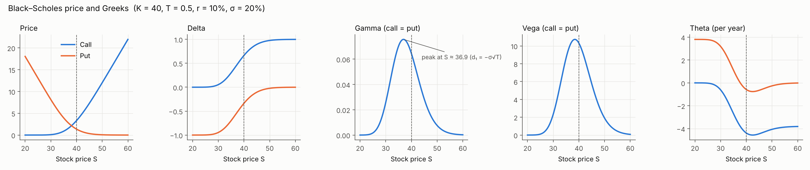
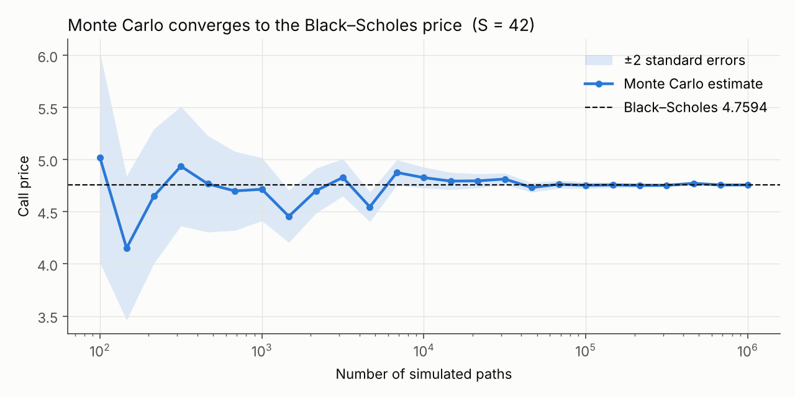

# option-pricing

Black–Scholes option pricing, Greeks and implied volatility in Python, with analytical, finite-difference and Monte Carlo validation.

## Status

| Component | Status |
| --- | --- |
| Black–Scholes call and put prices | Done |
| Put-call parity and textbook checks | Done |
| Greeks: Delta, Gamma, Vega, Theta, Rho | Done |
| Finite-difference validation of the Greeks | Done |
| Monte Carlo validation | Done |
| Plots of the Greeks and Monte Carlo convergence | Done |
| Implied volatility: bisection and Newton–Raphson | Done |
| Volatility smile from market option data | Next |

## Model

For a European option on a non-dividend-paying stock:

```text
d1 = [ln(S/K) + (r + σ²/2) T] / (σ √T)
d2 = d1 − σ √T

Call = S N(d1) − K e^(−rT) N(d2)
Put  = K e^(−rT) N(−d2) − S N(−d1)
```

## Greeks

| Greek | Measures | Call | Put |
| --- | --- | --- | --- |
| Delta | ∂V/∂S | N(d1) | N(d1) − 1 |
| Gamma | ∂²V/∂S² | n(d1) / (S σ √T) | same as call |
| Vega | ∂V/∂σ | S n(d1) √T | same as call |
| Theta | change in value as time passes | −S n(d1) σ / (2√T) − rK e^(−rT) N(d2) | −S n(d1) σ / (2√T) + rK e^(−rT) N(−d2) |
| Rho | ∂V/∂r | K T e^(−rT) N(d2) | −K T e^(−rT) N(−d2) |

`n(·)` is the standard normal density. Vega and Rho are per unit change (divide by 100 for a one-percentage-point move); Theta is per year (divide by 365 for one calendar day).

For the Hull example: call Delta 0.779, put Delta −0.221, Gamma 0.0500, Vega 8.81, call Theta −4.56, put Theta −0.75, call Rho 13.98, put Rho −5.04.

## Plots



- **Delta** moves from 0 to 1 for a call (−1 to 0 for a put); call Delta − put Delta = 1 at every price.
- **Gamma and Vega** are bell-shaped and identical for calls and puts. Gamma peaks where d1 = −σ√T, at S = K e^(−(r + 3σ²/2)T) ≈ 36.9, below the strike. (Setting d1 = 0 would miss the extra 1/S factor in Gamma = n(d1) / (S σ √T).)
- **Theta** is negative for calls. For a deep in-the-money European put it turns positive: the put is worth roughly K e^(−rT) − S, and that discounted strike grows as expiry approaches.



Each point is an independent simulation. The ±2 standard-error band narrows like 1/√n, and the estimates settle on the closed-form price.

## Validation

- **Textbook value:** Hull's Example 15.6 (S = 42, K = 40, T = 0.5, r = 10%, σ = 20%) gives a call of 4.76 and a put of 0.81.
- **Finite differences:** every analytical Greek is compared with a central difference of the pricing function (bump S, σ, r or T) across 24 parameter combinations, for calls and puts. This independent check caught an operator-precedence error in Theta during development: `x / 2 * sqrt(T)` puts √T in the numerator, and the put Theta came out positive.
- **Monte Carlo:** simulating S_T = S e^((r − σ²/2)T + σ√T Z) under the risk-neutral measure and discounting the average payoff reproduces the closed-form price. For the Hull example, 100,000 paths give a call of 4.7548 (closed form 4.7594, standard error 0.016) and a put of 0.8094 (closed form 0.8086). Tests require the estimate to lie within four standard errors of Black–Scholes for calls and puts across three parameter sets, and check that the standard error shrinks like 1/√n.
- **Put-call parity:** `C − P = S − K e^(−rT)` holds to 1e-10 across a grid of prices, volatilities and maturities. Parity follows from no-arbitrage alone, so it catches sign errors in the put formula that would otherwise run without error. Differentiating it gives the Greek relations that are also tested: call Delta − put Delta = 1, and calls and puts share Gamma and Vega.

## Implied volatility

Volatility is the one Black–Scholes input that cannot be observed. Implied volatility is the σ that makes the model price equal a given market price. Because Vega > 0, the price is strictly increasing in σ, so the root is unique.

| Method | Idea | Iterations (Hull example, true σ = 45%, tolerance 1e-8) |
| --- | --- | --- |
| Bisection | Halve [0.0001, 5] until it is narrower than the tolerance | 29 |
| Newton–Raphson | σ ← σ − (BS(σ) − price) / Vega(σ), starting from 20% | 4 |

Newton's errors in σ go 0.035 → 0.000078 → 0.0000000005: each step roughly squares the previous error (quadratic convergence), while bisection gains one binary digit per step.

**Safeguards**

- **No-arbitrage bounds.** A call price must lie in (max(S − Ke^(−rT), 0), S) and a put price in (max(Ke^(−rT) − S, 0), Ke^(−rT)). Outside these bounds no σ exists, so both solvers raise `ValueError` instead of returning a meaningless number.
- **Bisection fallback.** If Vega falls below 1e-8, or Newton has not converged in 50 steps, the solver switches to bisection.
- **Stopping on σ, not on price.** Newton first stopped when the price error fell below 1e-8. For a deep out-of-the-money put (S = 55, K = 40, T = 0.5, σ = 5%) the price is about 1e-23, and every σ up to about 8.6% also gives a price below 1e-8, so Newton stopped at 8.6%. It now stops when the step in σ is below the tolerance, and a regression test covers this case.

**Tests:** round trips for both solvers over 72 combinations of stock price, maturity, volatility and option type recover σ to within 1e-6; out-of-bounds prices raise `ValueError`; the deep out-of-the-money case above is tested explicitly.

## Run it

```bash
pip install -r requirements.txt
pytest
python -m examples.plot_greeks   # regenerates docs/greeks.png and docs/mc_convergence.png
```

```python
from pricing import bs_price, delta
bs_price(42, 40, 0.5, 0.10, 0.20, "call")   # 4.7594...
delta(42, 40, 0.5, 0.10, 0.20, "call")      # 0.7791...
from pricing import implied_vol_newton
implied_vol_newton(4.7594, 42, 40, 0.5, 0.10, "call")   # 0.2000...
```

