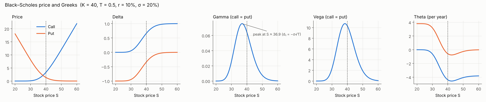
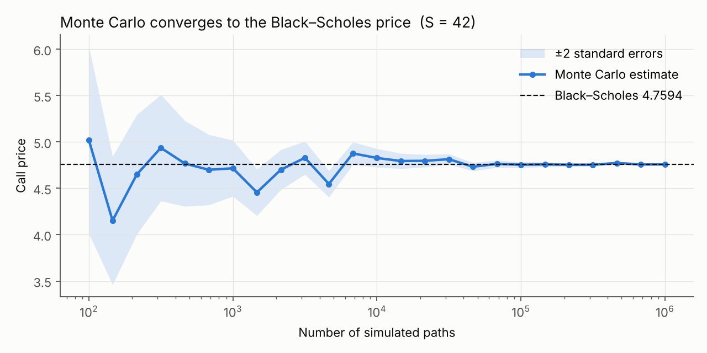
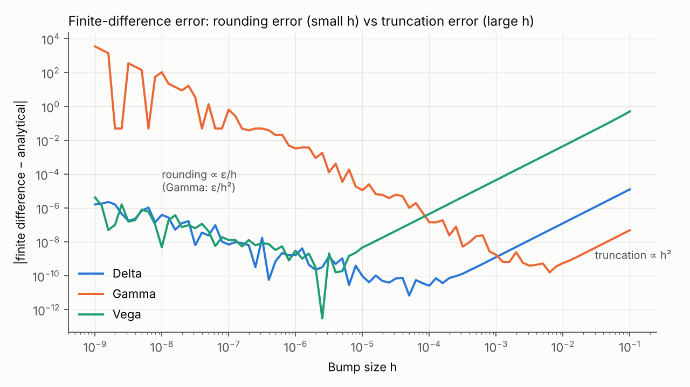
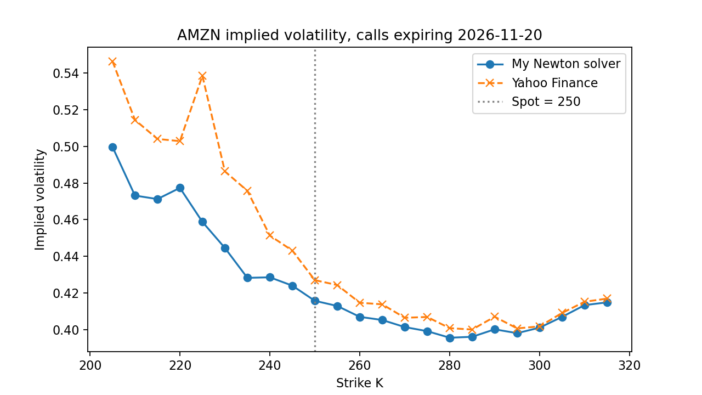
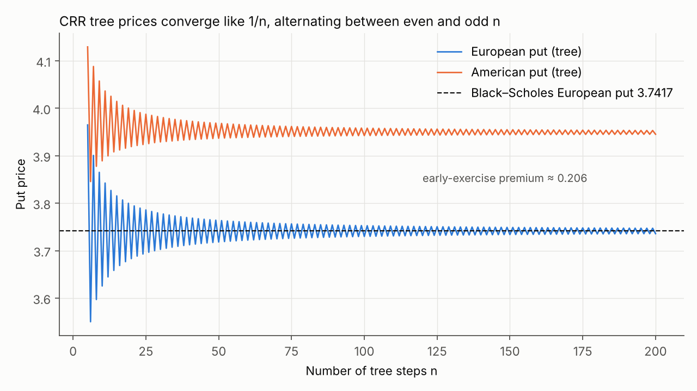
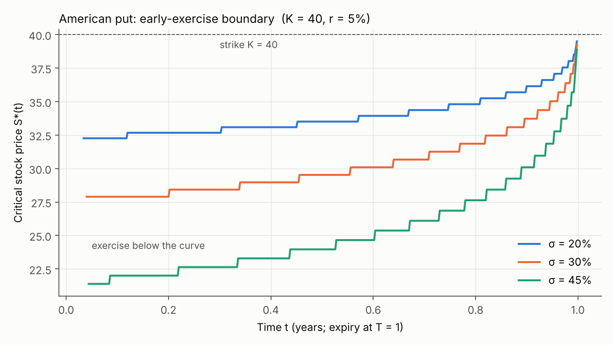

# option-pricing

Black–Scholes option pricing, Greeks, implied volatility and binomial trees for American options in Python, with analytical, finite-difference and Monte Carlo validation.

## Status

| Component | Status |
| --- | --- |
| Black–Scholes call and put prices | Done |
| Put-call parity and textbook checks | Done |
| Greeks: Delta, Gamma, Vega, Theta, Rho | Done |
| Finite-difference validation of the Greeks | Done |
| Finite-difference error vs bump size | Done |
| Monte Carlo validation | Done |
| Plots of the Greeks and Monte Carlo convergence | Done |
| Implied volatility: bisection and Newton–Raphson | Done |
| Volatility smile from market option data | Done |
| Binomial tree (CRR): European and American options | Done |
| American put early-exercise boundary | Done |
| Implied volatility of American puts | Done |

## Model

For a European option on a non-dividend-paying stock:

```text
d1 = [ln(S/K) + (r + σ²/2) T] / (σ √T)
d2 = d1 − σ √T

Call = S N(d1) − K e^(−rT) N(d2)
Put  = K e^(−rT) N(−d2) − S N(−d1)
```

## Greeks

| Greek | Measures | Call | Put |
| --- | --- | --- | --- |
| Delta | ∂V/∂S | N(d1) | N(d1) − 1 |
| Gamma | ∂²V/∂S² | n(d1) / (S σ √T) | same as call |
| Vega | ∂V/∂σ | S n(d1) √T | same as call |
| Theta | change in value as time passes | −S n(d1) σ / (2√T) − rK e^(−rT) N(d2) | −S n(d1) σ / (2√T) + rK e^(−rT) N(−d2) |
| Rho | ∂V/∂r | K T e^(−rT) N(d2) | −K T e^(−rT) N(−d2) |

`n(·)` is the standard normal density. Vega and Rho are per unit change (divide by 100 for a one-percentage-point move); Theta is per year (divide by 365 for one calendar day).

For the Hull example: call Delta 0.779, put Delta −0.221, Gamma 0.0500, Vega 8.81, call Theta −4.56, put Theta −0.75, call Rho 13.98, put Rho −5.04.

## Plots



- **Delta** moves from 0 to 1 for a call (−1 to 0 for a put); call Delta − put Delta = 1 at every price.
- **Gamma and Vega** are bell-shaped and identical for calls and puts. Gamma peaks where d1 = −σ√T, at S = K e^(−(r + 3σ²/2)T) ≈ 36.9, below the strike. (Setting d1 = 0 would miss the extra 1/S factor in Gamma = n(d1) / (S σ √T).)
- **Theta** is negative for calls. For a deep in-the-money European put it turns positive: the put is worth roughly K e^(−rT) − S, and that discounted strike grows as expiry approaches.



Each point is an independent simulation. The ±2 standard-error band narrows like 1/√n, and the estimates settle on the closed-form price.

## Validation

- **Textbook value:** Hull's Example 15.6 (S = 42, K = 40, T = 0.5, r = 10%, σ = 20%) gives a call of 4.76 and a put of 0.81.
- **Finite differences:** every analytical Greek is compared with a central difference of the pricing function (bump S, σ, r or T) across 24 parameter combinations, for calls and puts. This independent check caught an operator-precedence error in Theta during development: `x / 2 * sqrt(T)` puts √T in the numerator, and the put Theta came out positive.
- **Finite differences in detail** (`python -m examples.greeks_fd`): for the Hull example with h = 1e-4,

  | Greek | Analytical | Central difference | Absolute error |
  | --- | --- | --- | --- |
  | Delta | 0.77913129 | 0.77913129 | 2.6e-11 |
  | Gamma | 0.04996267 | 0.04996252 | 1.5e-07 |
  | Vega | 8.81341506 | 8.81341461 | 4.5e-07 |

  

  The error is V-shaped in h. For large h the Taylor remainder dominates and the error falls like h². For small h, subtracting two nearly equal prices loses digits: the rounding error grows like ε/h for Delta and Vega and like ε/h² for Gamma (ε ≈ 2.2e-16). The best bump sits where the two meet: about 5e-5 for Delta but about 6e-3 for Gamma, which divides by h². So one h does not suit every Greek: h = 1e-4 is near-optimal for Delta but leaves Gamma with a rounding error of 1.5e-7, which is why the Gamma test tolerance is looser.
- **Monte Carlo:** simulating S_T = S e^((r − σ²/2)T + σ√T Z) under the risk-neutral measure and discounting the average payoff reproduces the closed-form price. For the Hull example, 100,000 paths give a call of 4.7548 (closed form 4.7594, standard error 0.016) and a put of 0.8094 (closed form 0.8086). Tests require the estimate to lie within four standard errors of Black–Scholes for calls and puts across three parameter sets, and check that the standard error shrinks like 1/√n.
- **Put-call parity:** `C − P = S − K e^(−rT)` holds to 1e-10 across a grid of prices, volatilities and maturities. Parity follows from no-arbitrage alone, so it catches sign errors in the put formula that would otherwise run without error. Differentiating it gives the Greek relations that are also tested: call Delta − put Delta = 1, and calls and puts share Gamma and Vega.

## Implied volatility

Volatility is the one Black–Scholes input that cannot be observed. Implied volatility is the σ that makes the model price equal a given market price. Because Vega > 0, the price is strictly increasing in σ, so the root is unique.

| Method | Idea | Iterations (Hull example, true σ = 45%, tolerance 1e-8) |
| --- | --- | --- |
| Bisection | Halve [0.0001, 5] until it is narrower than the tolerance | 29 |
| Newton–Raphson | σ ← σ − (BS(σ) − price) / Vega(σ), starting from 20% | 4 |

Newton's errors in σ go 0.035 → 0.000078 → 0.0000000005: each step roughly squares the previous error (quadratic convergence), while bisection gains one binary digit per step.

**Safeguards**

- **No-arbitrage bounds.** A call price must lie in (max(S − Ke^(−rT), 0), S) and a put price in (max(Ke^(−rT) − S, 0), Ke^(−rT)). Outside these bounds no σ exists, so both solvers raise `ValueError` instead of returning a meaningless number.
- **Bisection fallback.** If Vega falls below 1e-8, or Newton has not converged in 50 steps, the solver switches to bisection.
- **Stopping on σ, not on price.** Newton first stopped when the price error fell below 1e-8. For a deep out-of-the-money put (S = 55, K = 40, T = 0.5, σ = 5%) the price is about 1e-23, and every σ up to about 8.6% also gives a price below 1e-8, so Newton stopped at 8.6%. It now stops when the step in σ is below the tolerance, and a regression test covers this case.

**Tests:** round trips for both solvers over 72 combinations of stock price, maturity, volatility and option type recover σ to within 1e-6; out-of-bounds prices raise `ValueError`; the deep out-of-the-money case above is tested explicitly.

### Volatility smile from market data



`examples/vol_smile.py` downloads the AMZN call chain expiring 2026-11-20 from Yahoo Finance (closing quotes of 16 Oct 2026, spot 250, 13-week T-bill rate 4.07%), prices each option at the bid-ask midpoint, drops quotes with no bid or a spread above 20% of the midpoint, and solves for implied volatility with `implied_vol_newton`.

If Black–Scholes held exactly, the curve would be flat. Instead implied volatility falls from about 50% at a strike of 205 to about 40% near 285, then turns up slightly: the equity skew. Out-of-the-money strikes match Yahoo's figures to within 0.01; the gap widens in the money, where Yahoo's numbers are reproduced closely by setting the interest rate to zero. Four deep in-the-money quotes fall below the no-arbitrage lower bound, so the bounds check rejects them.

Calls only: AMZN pays no dividend, so an American call is worth the same as a European one and Black–Scholes applies. American puts can be exercised early, so they are left out.

## Binomial tree and American options

`binomial_price` builds a Cox–Ross–Rubinstein tree: in each step of length dt = T/n the stock moves up by u = e^(σ√dt) or down by d = 1/u, with risk-neutral probability p = (e^(r dt) − d) / (u − d). Working backwards from expiry, each node is the discounted expected value of its two children. For an American option, each node is also compared with the value of exercising immediately, and the larger one is kept.

- **Convergence to Black–Scholes.** For S = K = 40, T = 1, r = 5%, σ = 30%, the European put's error is −0.0118 with 100 steps, −0.00118 with 1,000 and −0.00059 with 2,000: the error falls like 1/n (it also alternates between even and odd n, so the test compares even step counts).
- **American call = European call.** Without dividends, exercising a call early gives up its time value and the interest on K, so the early-exercise check never binds and the two prices agree to 1e-10.
- **American put > European put.** Deep in the money, a European put is worth about K e^(−rT) − S, which is less than the intrinsic value K − S. The American put can be exercised for K − S immediately. For the Hull example the American put is worth 0.910 against 0.809 for the European one.
- **Textbook value:** Hull's Example 21.1 (S = K = 50, T = 5/12, r = 10%, σ = 40%) gives 4.49 for the American put on a 5-step tree, and the tests reproduce it.



The tree price zigzags between even and odd n because the strike falls at a different place relative to the nodes, but both sequences close in on Black–Scholes like 1/n. The American put settles about 0.206 above the European one: the value of being allowed to exercise early.

### Early-exercise boundary

`american_put_boundary` records, at each step of the tree, the highest stock price at which exercising beats holding. Below this critical price S*(t) the put should be exercised immediately; above it, it should be held.



- **S* < K always and S* → K at expiry.** Close to expiry there is little time value left to give up, so exercising pays as soon as the put is in the money.
- **Higher volatility pushes S* down.** More volatility means more option value from waiting, so the stock has to fall further before exercising is worth it.
- **With r = 0 there is no early exercise.** Exercising early brings K forward, which is worth something only if K earns interest; a test checks that the boundary is empty when r = 0. (A tolerance of 1e-12·K is needed: in the deep in-the-money region holding and exercising are exactly equal when r = 0, and rounding error alone otherwise flagged early exercise.)
- **The steps are from the tree.** Node prices are discrete, so S* moves from one node level to the next. Successive steps alternate between two sets of node prices, so the plot uses every other step and the test checks that S* never falls within each set.

### Implied volatility of American puts

`implied_vol_american_put` finds the σ at which the American tree price matches a given price, by bisection (the tree price rises with σ, just like Black–Scholes).

- **Using the European formula on an American price overstates volatility.** For S = 36, K = 40, T = 1, r = 5%, σ = 25%, the American put is worth 5.217. The tree solver recovers 25.00%; `implied_vol_newton`, which assumes a European put, returns 27.93%, because it reads the early-exercise premium as extra volatility.
- **Bounds.** An American put is worth more than its intrinsic value K − S (not the discounted K e^(−rT) − S, as for a European put) and less than K. A price at intrinsic value has no unique σ: deep in the money at low volatility the put is exercised at once and is worth exactly K − S for every low enough σ (S = 32, K = 40, σ = 15% is an example in the tests), so the solver raises `ValueError`.
- **Lower end of the bracket.** The CRR tree needs d < e^(r dt) < u, which means σ > r√dt; below that the risk-neutral probability leaves (0, 1). The bisection therefore starts just above r√(T/n) instead of at 0.0001.

## Run it

```bash
pip install -r requirements.txt
pytest
python -m examples.plot_greeks   # regenerates docs/greeks.png and docs/mc_convergence.png
python -m examples.greeks_fd     # finite-difference table and docs/greeks_fd_error.png
python -m examples.plot_binomial # docs/binomial_convergence.png and docs/put_boundary.png
```

```python
from pricing import bs_price, delta
bs_price(42, 40, 0.5, 0.10, 0.20, "call")   # 4.7594...
delta(42, 40, 0.5, 0.10, 0.20, "call")      # 0.7791...
from pricing import implied_vol_newton
implied_vol_newton(4.7594, 42, 40, 0.5, 0.10, "call")   # 0.2000...
from pricing import binomial_price
binomial_price(42, 40, 0.5, 0.10, 0.20, "put", n=2000, american=True)   # 0.9102...
```

